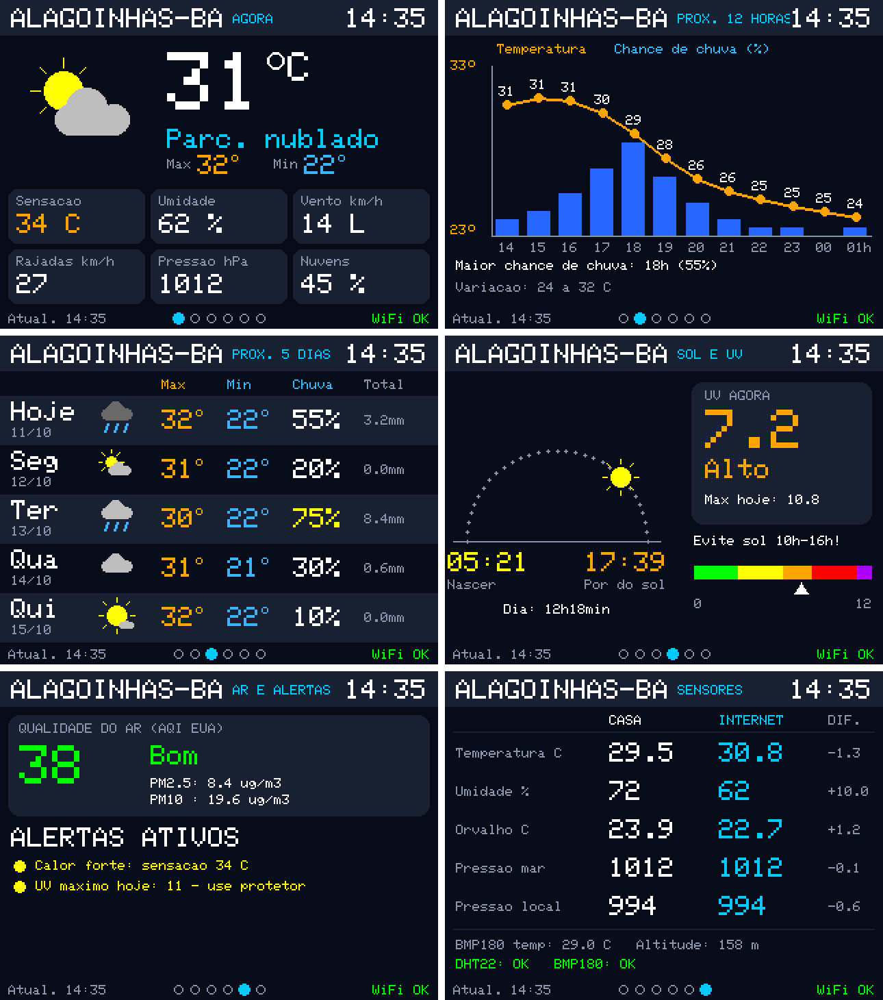
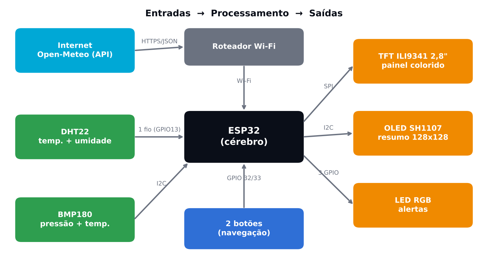
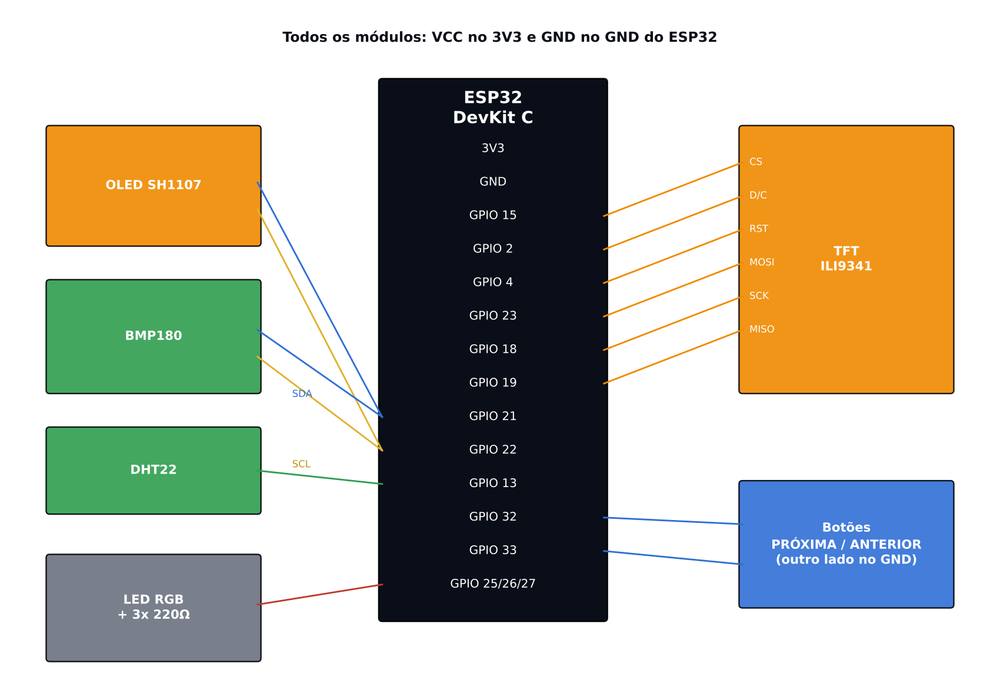
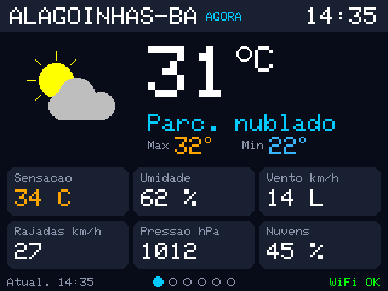
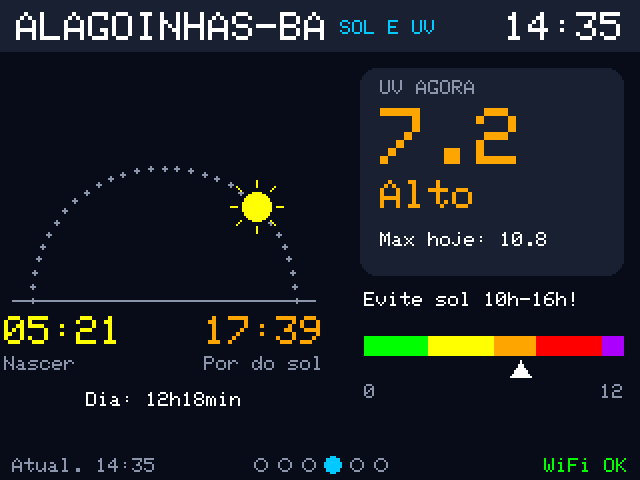
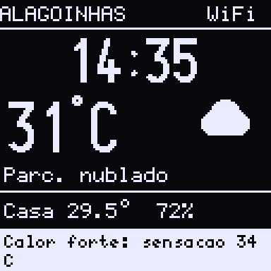

#  Nexora · Estação Meteorológica (Alagoinhas-BA)

Módulo 1 do **Nexora**, um projeto de automação residencial, empresarial e de processos de baixo custo com ESP32 e Arduino.

A estação junta **dados reais da internet** sobre Alagoinhas-BA com **medições locais** feitas por sensores. Tudo aparece num painel colorido de 6 páginas, com um resumo fixo numa OLED e um LED RGB que avisa quando algo pede atenção.



> **Status:** ✅ testado e funcionando no simulador [Wokwi](https://wokwi.com) (ESP32 + Wi-Fi virtual).
> Montagem física: ainda não feita (lista de compras abaixo).

---

##  Funcionalidades

- **Condições atuais:** temperatura, sensação térmica, umidade, vento com direção, rajadas, pressão e nebulosidade.
- **Previsão:** gráfico das próximas 12 horas (temperatura + chance de chuva) e tabela dos próximos 5 dias.
- **Sol e UV:** nascer e pôr do sol, arco com a posição do sol, duração do dia, índice UV com escala de cores e recomendação.
- **Qualidade do ar:** AQI (padrão EUA), PM2.5 e PM10.
- **Alertas automáticos:** calor, UV, vento, chuva, trovoada, qualidade do ar, casa quente e Wi-Fi caído.
- **Sensores locais:** DHT22 (temperatura e umidade) e BMP180 (pressão), comparados com os dados da internet.
- **Cálculos no próprio ESP32:** ponto de orvalho (fórmula de Magnus) e pressão ao nível do mar (fórmula barométrica).
- **Navegação:** as páginas trocam sozinhas a cada 10 s. Os botões avançam e voltam, e a troca automática pausa por 30 s depois de usar um botão.
- **LED de estado:** 🟢 tudo ok · 🟡 atenção · 🔴 alerta (piscando) · 🔵 sem Wi-Fi.

##  Arquitetura



| Entrada | Processamento | Saída |
|---|---|---|
| API Open-Meteo (HTTPS/JSON) via Wi-Fi | ESP32 DevKit C | TFT ILI9341 2,8" (SPI) |
| DHT22 (1 fio) | parsing do JSON (ArduinoJson) | OLED SH1107 128×128 (I2C) |
| BMP180 (I2C) | regras de alerta | LED RGB |
| 2 botões (pull-up interno) | loop não bloqueante com `millis()` | Serial Monitor (log) |

**Fonte dos dados:** [Open-Meteo](https://open-meteo.com), gratuita para uso não comercial e sem chave de API.
- Previsão: `api.open-meteo.com/v1/forecast` (atualizada a cada 10 min)
- Qualidade do ar: `air-quality-api.open-meteo.com/v1/air-quality` (a cada 30 min)
- Hora certa: NTP (`pool.ntp.org`), fuso UTC−3

##  Ligações



| Componente | Pino do componente | ESP32 |
|---|---|---|
| TFT ILI9341 | VCC / LED / GND | 3V3 / 3V3 / GND |
| | CS / D/C / RST | GPIO 15 / 2 / 4 |
| | MOSI / SCK / MISO | GPIO 23 / 18 / 19 |
| OLED SH1107 (I2C 0x3C) | VCC / GND / SDA / SCL | 3V3 / GND / 21 / 22 |
| BMP180 (I2C 0x77) | VCC / GND / SDA / SCL | 3V3 / GND / 21 / 22 |
| DHT22 | VCC / GND / dados | 3V3 / GND / GPIO 13 |
| Botão PRÓXIMA | um lado / outro | GPIO 32 / GND |
| Botão ANTERIOR | um lado / outro | GPIO 33 / GND |
| LED RGB (cátodo comum) | R / G / B (cada um com 220 Ω) / COM | GPIO 25 / 26 / 27 / GND |

> ⚠️ O ESP32 trabalha com **3,3 V**. Não ligue sinais de 5 V nos pinos dele.

## ▶️ Como rodar

### Opção 1: Wokwi no navegador (gratuito)

1. Em [wokwi.com](https://wokwi.com), faça login e crie **New Project → ESP32** (Arduino).
2. Cole [`sketch.ino`](sketch.ino) na aba `sketch.ino`.
3. Cole [`diagram.json`](diagram.json) na aba `diagram.json`.
4. Crie o arquivo `libraries.txt` com o conteúdo de [`libraries.txt`](libraries.txt).
5. Clique em **▶**. No Serial Monitor deve aparecer `[WiFi] conectado!` e depois `[CLIMA] ...`.
6. Clique no DHT22 e no BMP180 durante a simulação para mudar os valores e testar os alertas.

> No plano gratuito do Wokwi a compilação entra numa fila compartilhada. Em horário de pico pode demorar alguns minutos: espere e tente de novo.

### Opção 2: PlatformIO + Wokwi para VS Code

O `platformio.ini` compila o `sketch.ino` da raiz (`src_dir = .`) e baixa as bibliotecas sozinho.

```bash
pio run            # compila; gera .pio/build/esp32dev/firmware.bin
```

Depois, no VS Code com a extensão Wokwi, rode **Wokwi: Start Simulator**. O `wokwi.toml` aponta para o firmware gerado e usa o mesmo `diagram.json`.

### Bibliotecas

`Adafruit GFX Library` · `Adafruit ILI9341` · `Adafruit BusIO` · `U8g2` · `DHT sensor library` · `Adafruit Unified Sensor` · `Adafruit BMP085 Library` · `ArduinoJson` (v7)

O código compila sem erros nos núcleos ESP32 Arduino **2.0.9** e **3.3.2**.

## ⚙️ Configuração

Tudo fica no topo do `sketch.ino`:

```cpp
const char* WIFI_SSID    = "Wokwi-GUEST";   // na montagem física: sua rede
const char* WIFI_PASS    = "";              // e sua senha
const int   WIFI_CHANNEL = 6;               // no físico: 0 (automático)

const float LATITUDE   = -12.1356;          // Alagoinhas-BA
const float LONGITUDE  = -38.4192;
const float ALTITUDE_M = 158.0;             // usada para corrigir a pressão
```

Para usar em outra cidade, troque latitude, longitude, altitude e `CITY_NAME`.

##  As telas

| Página | Conteúdo |
|---|---|
| 1 · Agora | ícone, temperatura, máx/mín, sensação, umidade, vento, rajadas, pressão, nuvens |
| 2 · Próximas 12h | gráfico de temperatura + barras de chance de chuva |
| 3 · Próximos 5 dias | máx/mín, chance e total de chuva por dia |
| 4 · Sol e UV | arco do sol, nascer/pôr, UV atual e máximo, recomendação |
| 5 · Ar e alertas | AQI, PM2.5, PM10 e lista de alertas ativos |
| 6 · Sensores | casa × internet: temperatura, umidade, orvalho, pressão |

<p>
 
</p>
<p>

</p>

> As imagens acima foram geradas pelo próprio código de desenho, com dados de exemplo no formato da Open-Meteo. No Wokwi aparecem os dados reais do momento.

##  Regras de alerta

| Situação | Atenção 🟡 | Alerta 🔴 |
|---|---|---|
| Sensação térmica | ≥ 33 °C | ≥ 38 °C |
| UV | máximo do dia ≥ 8 | agora ≥ 8 |
| Rajadas de vento | ≥ 40 km/h | ≥ 60 km/h |
| Chance de chuva nas próximas 6 h | ≥ 70 % | — |
| Chuva prevista no dia | — | ≥ 30 mm |
| Tempo agora | — | trovoada, chuva forte |
| Qualidade do ar (AQI) | > 100 | > 150 |
| Temperatura dentro de casa | ≥ 35 °C | — |
| Wi-Fi | desconectado | — |

## 🛒 Lista de compras (montagem física)

Preços aproximados em R$. Só o ESP32 foi conferido numa loja (out/2026); os demais são estimativas.

| Item | Qtd | Preço aprox. |
|---|---|---|
| ESP32 DevKitC V4 WROOM-32 (38 pinos) | 1 | 57 – 60 |
| Display TFT 2,8" SPI ILI9341 240×320 | 1 | 60 – 110 |
| Display OLED 128×128 I2C SH1107 | 1 | 50 – 130 |
| Sensor DHT22 / AM2302 (módulo) | 1 | 30 – 50 |
| Sensor BMP180 (GY-68) ou BMP280 | 1 | 12 – 25 |
| LED RGB 5 mm cátodo comum | 1 | 1 – 3 |
| Resistores 220 Ω (+ 2× 100 Ω opcionais) | 3 | 1 – 3 |
| Botão táctil 12 mm | 2 | 2 – 5 |
| Protoboard 830 pontos | 1 | 15 – 25 |
| Kit de jumpers | 1 | 15 – 25 |
| Cabo micro-USB de dados | 1 | 10 – 20 |
| **Total estimado** | | **≈ 250 – 450** |

### Diferenças do Wokwi para o físico

- **Wi-Fi:** use o nome e a senha da sua rede e `WIFI_CHANNEL = 0`.
- **OLED:** se a imagem sair deslocada (comum na Grove da Seeed), mude `#define USE_SEEED_OLED` para `1`.
- **BMP280 no lugar do BMP180:** use a biblioteca `Adafruit BMP280`, declare `Adafruit_BMP280 bmp;` e inicie com `bmp.begin(0x76)`.
- **LED RGB:** 100 Ω no verde e no azul deixam o brilho mais parecido com o vermelho.
- **DHT22:** deixe longe do ESP32 e da tela, que esquentam e alteram a leitura.

## 📚 Documentação de estudo

O PDF [`Nexora_Estacao_Meteorologica.pdf`](Nexora_Estacao_Meteorologica.pdf) (28 páginas) explica tudo do zero: analogias, Wi-Fi, API, HTTPS, JSON, NTP, meteorologia, SPI × I2C, cores RGB565, pull-up, Lei de Ohm no LED, `millis()`, e os cálculos passo a passo (orvalho, pressão, gráfico, arco do sol).

##  Próximos passos

- [ ] Montagem física
- [ ] Histórico de pressão das últimas 24 h (tendência de chuva)
- [ ] Ligar um relé (ventilador) quando a casa passar de 30 °C
- [ ] Página web no Wi-Fi local para ver o painel pelo celular
- [ ] Publicar as leituras via MQTT para os outros módulos do Nexora
- [ ] Validar o certificado HTTPS em vez de `setInsecure()`

## 📁 Estrutura

```
estacao-meteorologica-esp32/
├── README.md
├── sketch.ino                         # código do ESP32
├── diagram.json                       # circuito do Wokwi
├── libraries.txt                      # bibliotecas (Wokwi no navegador)
├── platformio.ini                     # compilação local com PlatformIO
├── wokwi.toml                         # Wokwi para VS Code (usa o firmware do PlatformIO)
├── Nexora_Estacao_Meteorologica.pdf   # material de estudo
└── docs/img/                          # prévias das telas e diagramas
```

---

Dados meteorológicos: [Open-Meteo](https://open-meteo.com) (CC BY 4.0). Qualidade do ar: Copernicus Atmosphere Monitoring Service (CAMS) via Open-Meteo.
